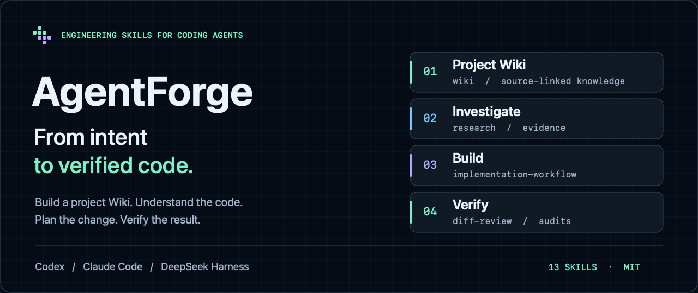
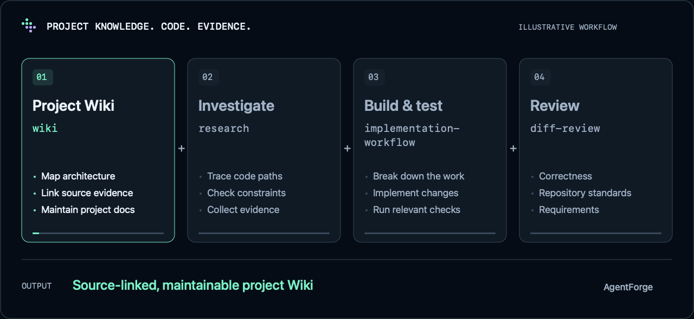

<p align="center">
  
</p>

<p align="center">
  <a href="https://github.com/Lixiuxiu559/AgentForge/actions/workflows/validate.yml"></a>
  <a href="LICENSE"></a>
  
</p>

<p align="center"><a href="README.md">简体中文</a> · English</p>

# Engineering workflows for your coding agent

**AgentForge is an engineering skills plugin for coding agents.** Build a Project Wiki to preserve code knowledge, then use practical workflows to implement and validate changes. The skills cover understanding a repository, building features, debugging, reviewing changes and assessing tests.

Install it in **Codex, Claude Code or DeepSeek Harness** and work in your existing repository. You set the goal; the agent uses the skills to organize investigation, implementation and validation, then reports results and unresolved issues.

[Get started](#get-started) · [Project Wiki](#project-knowledge-that-developers-and-agents-can-navigate) · [All skills](#choose-from-thirteen-skills) · [Installation and updates](docs/installation.md)

## What you can do

### Project knowledge that developers and agents can navigate

When joining an unfamiliar repository, investigating complex modules or preparing for future development, use `wiki` to generate a Project Wiki from the actual code. It explains architecture, module responsibilities, key flows and development practices, with source references for key conclusions.

- **A code guide for developers:** navigate from the project overview to architecture, modules and flows, then follow source links to the implementation.
- **A knowledge entry point for agents:** use the catalog and page summaries to choose what to read, and check the code before making key decisions.
- **Knowledge maintained alongside code:** Markdown lives in the repository's `docs/wiki/`, ready to commit, review and update when the code changes.

```text
Use wiki to generate an English Project Wiki for this repository, covering
architecture, core modules, key flows and a development guide.
```

For an existing Wiki:

```text
Use wiki to update the pages affected by these code changes,
verify the source references, and run check when done.
```

`check` validates the catalog, pages, language and links. Content accuracy still requires checking the code. [Explore AgentForge's own Project Wiki](docs/wiki/README.md) (Chinese).

### Deliver features with clear validation

With a clear goal, the agent assesses the impact, breaks down the work, implements changes and runs relevant checks. Independent tasks can use the host's sub-agent capability to run in parallel. The agent then integrates the work and explains what changed, how it was validated and what remains.

```text
Use implementation-workflow to add CSV export to this project. Follow the existing
permission and filtering rules, add necessary tests, and report changes and validation results.
```

### Base fixes on causes and evidence

Start with a specific symptom, reproduce it, trace the code paths and validate the root cause. `bug-debugging` presents evidence and a repair proposal, waits for your approval, then implements the fix and checks the original scenario.

```text
Use bug-debugging to investigate this intermittent request timeout.
First explain the cause, evidence and proposed fix.
```

### Review the important questions before committing

`diff-review` checks correctness, repository standards and requirements separately. When you need more evidence, audit complexity and coverage risks, or use the project's existing mutation-testing tools to assess whether tests catch logic errors.

```text
Use diff-review to review the current changes. Report correctness,
standards and requirements findings separately.
```

## How the skills can work together



*This illustrates capabilities; it is not a host recording. Choose the skills your task needs. Running the entire sequence is optional. [View the still image](docs/assets/workflow.en.png).*

Use `pm` to clarify requirements, or `prototype` and `architecture-design` to explore pages and technical approaches in readable HTML. If the requirements are already clear, you can go straight to implementation.

## Get started

### Codex

```bash
codex plugin marketplace add Lixiuxiu559/AgentForge
codex plugin add agentforge@agentforge
```

Start a new task after installation and try one of the examples above.

### Claude Code

```bash
claude plugin marketplace add Lixiuxiu559/AgentForge
claude plugin install agentforge@agentforge
```

Restart Claude Code after installation. You can also select a skill explicitly with commands such as `/agentforge:implementation-workflow`.

### DeepSeek Harness

In the desktop app, open **Plugins → Add plugin** in the sidebar, enter `github:Lixiuxiu559/AgentForge`, then install and enable it.

Web / CLI:

```bash
dsh plugin --profile web add github:Lixiuxiu559/AgentForge
```

Restart the corresponding profile after installation. See [Installation and updates](docs/installation.md) (Chinese) for updates, local installation, pinned versions and troubleshooting.

## Choose from thirteen skills

| What you want to do | Skill | What you get |
|---|---|---|
| Build and maintain project knowledge | [`wiki`](skills/wiki/SKILL.md) | A Project Wiki for developers and agents: navigation, architecture and module guides, source references and updates based on code changes |
| Implement a feature | [`implementation-workflow`](skills/implementation-workflow/SKILL.md) | Task breakdown, code changes, integration checks and a delivery report |
| Diagnose and fix a bug | [`bug-debugging`](skills/bug-debugging/SKILL.md) | Reproduction and root-cause evidence, a proposal for approval, then an approved fix and regression checks |
| Review changes before committing | [`diff-review`](skills/diff-review/SKILL.md) | Separate findings for correctness, standards and requirements |
| Investigate code or technical questions | [`research`](skills/research/SKILL.md) | Evidence-based conclusions from multi-step investigation and cross-checking |
| Turn an idea into a reviewable design | [`pm`](skills/pm/SKILL.md) · [`prototype`](skills/prototype/SKILL.md) · [`architecture-design`](skills/architecture-design/SKILL.md) | A PRD, page prototype or technical design, delivered as HTML by default |
| Assess test protection | [`test-design`](skills/test-design/SKILL.md) · [`mutation-testing`](skills/mutation-testing/SKILL.md) | Gaps in business scenarios and assertions, or an audit using existing mutation-testing tools |
| Assess change risk and refactoring opportunities | [`complexity-audit`](skills/complexity-audit/SKILL.md) · [`architecture-scout`](skills/architecture-scout/SKILL.md) | Complexity and coverage risks, or evidence-based architecture candidates; architecture investigation requires an explicit user request |
| Prepare a separate development directory | [`worktree`](skills/worktree/SKILL.md) | Create or safely remove a Git worktree while preserving the branch |

## Work in your existing development environment

Skills are maintained in Markdown and share one source of methods and references. The bundled JavaScript has zero dependencies, and no MCP service is required. Your host provides the model, tools and execution permissions. Scripts use Node.js; Git operations require Git.

Parallel execution depends on the host's generic sub-agent capability; otherwise, work proceeds sequentially. Audits reuse the project's existing tools and report limitations when tools or data are missing. Review and audit skills report findings; fixing them is a separate task.

## Contribute

```bash
node tools/doctor.mjs
npm test
```

Structural checks validate plugin manifests, versions and skill resources. Tests cover skill loading, invocation policies, Wiki tools and release scripts. Model behavior in a real host still requires direct validation.

[Project Wiki](docs/wiki/README.md) · [Architecture](docs/architecture.md) · [Releasing](docs/releasing.md) · [Changelog](CHANGELOG.md) · [Artwork sources](docs/assets/README.md) — supporting documentation is primarily in Chinese.

## License

[MIT](LICENSE) · Copyright (c) 2026 lixiuxiu
