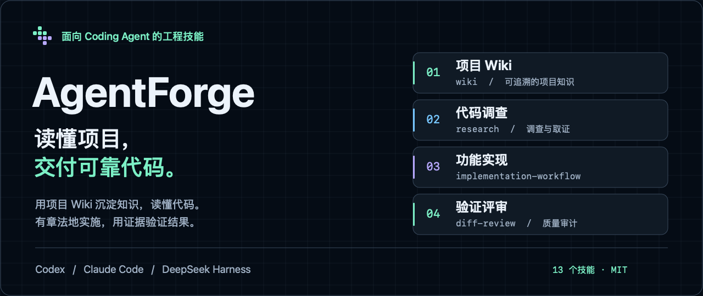
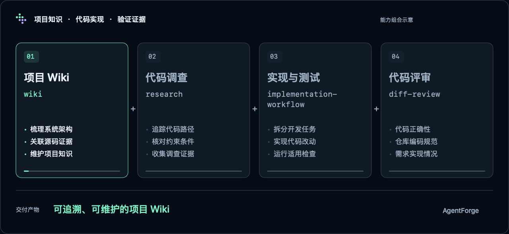

<p align="center">
  
</p>

<p align="center">
  <a href="https://github.com/Lixiuxiu559/AgentForge/actions/workflows/validate.yml"></a>
  <a href="LICENSE"></a>
  
</p>

# 让 Coding Agent 有章法地交付代码

**AgentForge 是一套面向 Coding Agent 的工程技能插件。** 用项目 Wiki 沉淀代码知识，用工程工作流推进实现与验证，覆盖理解仓库、开发功能、定位 Bug、评审改动和检查测试。

安装到 **Codex、Claude Code 或 DeepSeek Harness**，在你已有的仓库里工作。你提出目标，Agent 按技能组织调查、实施与验证，并交代结果和未解决的问题。

[开始使用](#开始使用) · [项目 Wiki](#让开发者和-agent-都读得懂你的项目) · [全部技能](#按需选择十三个技能) · [安装与更新](docs/installation.md)

## 能帮你做什么

### 让开发者和 Agent 都读得懂你的项目

接手陌生仓库、梳理复杂模块，或让下一次开发少从头摸索：`wiki` 基于实际代码生成项目 Wiki，讲清架构、模块职责、关键流程和开发方式，关键结论附源码位置。

- **给开发者一份代码导读**：从项目概览进入架构、模块与流程，沿来源链接回到实现。
- **给 Agent 一个知识入口**：按目录和页面摘要选择要读的内容，关键决策再回源码核实。
- **让知识随代码一起维护**：Markdown 保存在仓库的 `docs/wiki/`，可提交、评审，也可按代码改动更新受影响的页面。

```text
用 wiki 为这个项目生成中文 Wiki，覆盖架构、核心模块、关键流程和开发指南。
```

已有 Wiki 时，也可以直接要求：

```text
用 wiki 按这次代码改动更新受影响的页面，核对源码来源，最后运行 check。
```

`check` 检查目录、页面、语言和链接；内容是否准确仍需核对代码。[查看 AgentForge 自己的项目 Wiki](docs/wiki/README.md)。

### 把功能做完，也把验证说清楚

明确目标后，Agent 评估影响、拆分任务、实现代码并运行适用的检查。独立任务可借助宿主的子 Agent 并行推进，最后统一集成，说明改了什么、如何验证、还缺什么。

```text
用 implementation-workflow 给这个项目增加 CSV 导出，沿用现有权限和筛选规则，
补齐必要的测试，完成后说明改动和验证结果。
```

### 让修复建立在原因和证据上

从具体症状出发，复现问题、追踪调用链、验证根因。`bug-debugging` 先展示证据和修复方案，等你同意后再实施，随后回归原始场景。

```text
用 bug-debugging 排查这个请求偶尔超时的问题，先给出原因、证据和修复方案。
```

### 在提交前，多看一遍关键问题

`diff-review` 分别检查正确性、仓库规范和需求实现。需要进一步判断时，可以审计复杂度与覆盖率风险，或用项目已有的突变测试工具检查测试是否能发现逻辑错误。

```text
用 diff-review 评审当前改动，分别报告正确性、规范和需求实现的问题。
```

## 一次开发，可以这样协作



*能力组合示意，并非宿主实录。按任务选择技能，不要求跑完整条流程。[查看静态图](docs/assets/workflow.zh-CN.png) · [English visuals](docs/assets/README.md)。*

需要先理清需求时，用 `pm` 整理 PRD；需要看页面或比较技术路线时，用 `prototype`、`architecture-design` 产出可阅读的 HTML。需求已经明确，也可以直接进入实施。

## 开始使用

### Codex

```bash
codex plugin marketplace add Lixiuxiu559/AgentForge
codex plugin add agentforge@agentforge
```

安装后开启新任务，直接输入上面的使用示例。

### Claude Code

```bash
claude plugin marketplace add Lixiuxiu559/AgentForge
claude plugin install agentforge@agentforge
```

安装后重启 Claude Code。也可以用 `/agentforge:implementation-workflow` 等命令明确选择技能。

### DeepSeek Harness

桌面端在侧栏 **插件 → 添加插件** 中填入 `github:Lixiuxiu559/AgentForge`，安装后启用。

Web / CLI：

```bash
dsh plugin --profile web add github:Lixiuxiu559/AgentForge
```

安装后重启对应 profile。更新、本地安装、固定版本与故障检查见[安装与更新](docs/installation.md)。

## 按需选择十三个技能

| 你要做的事 | 使用技能 | 得到什么 |
|---|---|---|
| 建立与维护项目知识 | [`wiki`](skills/wiki/SKILL.md) | 开发者和 Agent 共用的项目 Wiki：目录导航、架构与模块说明、源码来源、按变更更新 |
| 实现功能 | [`implementation-workflow`](skills/implementation-workflow/SKILL.md) | 任务拆分、代码实现、集成验证与交付说明 |
| 排查并修复 Bug | [`bug-debugging`](skills/bug-debugging/SKILL.md) | 复现与根因证据、待确认方案、获批后的修复与回归 |
| 提交前评审 | [`diff-review`](skills/diff-review/SKILL.md) | 正确性、规范、需求三条轴各自的评审结果 |
| 调查代码与技术问题 | [`research`](skills/research/SKILL.md) | 多步取证、交叉验证后给出有证据的结论 |
| 把想法变成可评审的设计 | [`pm`](skills/pm/SKILL.md) · [`prototype`](skills/prototype/SKILL.md) · [`architecture-design`](skills/architecture-design/SKILL.md) | PRD、页面原型、技术设计，默认交付 HTML |
| 检查测试保护 | [`test-design`](skills/test-design/SKILL.md) · [`mutation-testing`](skills/mutation-testing/SKILL.md) | 业务场景与断言缺口，或已有突变工具的审计结果 |
| 判断修改风险与重构机会 | [`complexity-audit`](skills/complexity-audit/SKILL.md) · [`architecture-scout`](skills/architecture-scout/SKILL.md) | 复杂度与覆盖率风险，或有依据的架构候选；架构调查由你主动发起 |
| 为开发准备独立工作目录 | [`worktree`](skills/worktree/SKILL.md) | 创建或安全移除 Git worktree，保留分支 |

## 在你现有的开发环境中工作

技能以 Markdown 维护，共用一份方法与参考资料。包内 JavaScript 零 dependencies，无必需 MCP 服务；模型、工具和执行权限由你使用的宿主提供。脚本使用 Node.js，Git 操作需要 Git。

并行执行取决于宿主是否提供通用子 Agent 能力；不可用时串行处理。审计复用项目已有工具，数据或工具不足时明确说明限制。评审与审计技能只报告问题，是否修复由后续任务决定。

## 参与开发

```bash
node tools/doctor.mjs
npm test
```

结构检查验证插件清单、版本与技能资源，测试覆盖技能加载、调用策略、Wiki 工具和发版脚本。真实宿主中的模型行为仍需实际验证。

[项目 Wiki](docs/wiki/README.md) · [架构说明](docs/architecture.md) · [发布流程](docs/releasing.md) · [更新记录](CHANGELOG.md) · [视觉素材源文件](docs/assets/README.md)

## 许可证

[MIT](LICENSE) · Copyright (c) 2026 lixiuxiu
