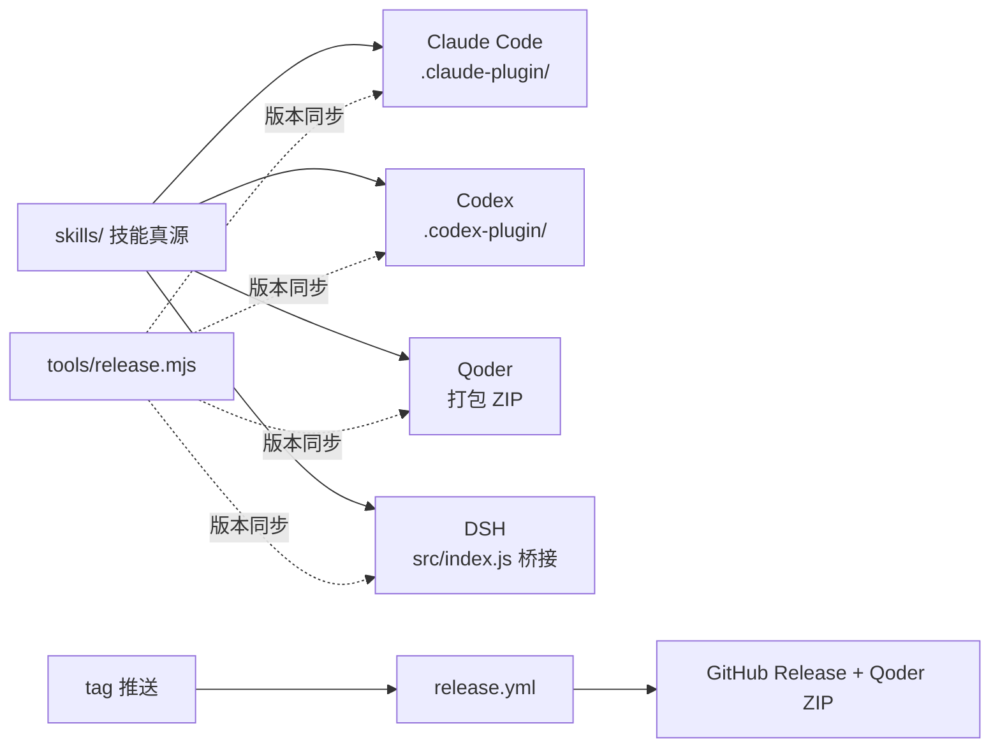

# 系统架构

> 说明十三个技能如何以一份真源分发到四个宿主、DSH 桥接如何加载技能，以及打包与发布链路的边界；不展开单个技能的方法细节。

## 概述

AgentForge 是一个技能集插件：方法真源只有 `skills/<name>/SKILL.md` 与其 `references/`、`scripts/`，不维护任何自定义 agent 定义，也不把同一套方法复制成宿主专用提示词。四个宿主的差异全部落在清单、桥接和打包上。

| 组件 | 职责 | 位置 |
|---|---|---|
| 技能真源 | 十三个技能的方法、参考与脚本 | [skills](../../skills) |
| Claude Code 清单 | 插件名、版本与描述；市场文件指向仓库根 | [.claude-plugin/plugin.json](../../.claude-plugin/plugin.json) |
| Codex 清单 | `skills: "./skills/"` 与展示信息 | [.codex-plugin/plugin.json](../../.codex-plugin/plugin.json) |
| Codex 市场 | 指向仓库根 `./` 的本地插件条目 | [.agents/plugins/marketplace.json](../../.agents/plugins/marketplace.json) |
| Qoder 清单 | ZIP 内的插件清单，只声明 `./skills/` | [.qoder-plugin/plugin.json](../../.qoder-plugin/plugin.json) |
| DSH 桥接 | 注册技能提供者，按需加载技能正文 | [src/index.js](../../src/index.js#L194) |
| DSH 装载 | `dsh.bundle.patch` 指向的 Cordis 层 | [cordis.patch.yml](../../cordis.patch.yml) |
| 打包与发版 | Qoder ZIP、版本同步、CHANGELOG 提取 | [tools](../../tools) |

## 核心流程

### 宿主如何拿到技能

- **Claude Code**：读取 `.claude-plugin/plugin.json` 与 `.claude-plugin/marketplace.json`，按插件根下的 `skills/` 自动发现技能。技能以 `/agentforge:<name>` 命名空间调用，裸名不会抢占内置命令。
- **Codex**：`.codex-plugin/plugin.json` 用 `skills: "./skills/"` 指向技能目录；`.agents/plugins/marketplace.json` 把仓库根注册为本地插件来源。`architecture-scout` 的 `agents/openai.yaml` 只是 Codex 侧的调用策略元数据，不是子 agent 定义。
- **Qoder**：不直接读仓库，而是由 `tools/package-qoder.mjs` 生成只含 `.qoder-plugin/plugin.json`、`skills/`、`LICENSE` 和 README 的 ZIP。
- **DSH**：按 npm 包安装，`package.json` 的 `main` 指向桥接插件，`dsh.bundle.patch` 指向 `cordis.patch.yml`；`files` 白名单必须包含 `src`、`skills`、`cordis.patch.yml`，否则装出来的包注册不到任何技能（[package.json](../../package.json#L30)）。

### DSH 桥接

`src/index.js` 导出的插件在 `apply` 中注册技能提供者（[apply](../../src/index.js#L194)）。提供者的 `list()` 每次调用重新扫描 `skills/`（[scanSkills](../../src/index.js#L104)），新增、改名、删除技能不需要重启宿主；`get()` 才读取正文，catalog 阶段只带 frontmatter（[provider.get](../../src/index.js#L169)）。

| 机制 | 行为 | 依据 |
|---|---|---|
| frontmatter 解析 | 只支持顶层键、单行标量与 `|` / `>` 块标量，不引 YAML 库 | [parseFrontmatterFile](../../src/index.js#L38) |
| 硬性字段 | 缺 `name` 或 `description` 的技能整条丢弃 | [scanSkills](../../src/index.js#L137) |
| 调用策略 | `dsh-model-invocable: false` 或 `disable-model-invocation: true` 关闭模型主动调用；`user-invocable: false` 移出命令面板 | [invocation](../../src/index.js#L145) |
| 资源根 | `resourceBase` 为技能所在目录，正文按需读取 | [get](../../src/index.js#L180) |
| 插件根占位符 | DSH 没有 `${CLAUDE_PLUGIN_ROOT}`，加载时展开为真实包路径 | [expandPluginRoot](../../src/index.js#L189) |

## 数据流

一次 Qoder 发版的完整链路：

1. `node tools/release.mjs <patch|minor|major|x.y.z>` 同步四处版本号、把 CHANGELOG 的 Unreleased 转为正式版本段、提交并打附注标签（[release.mjs](../../tools/release.mjs#L190)）。
2. 推送 tag 触发 `.github/workflows/release.yml`：构建 Qoder ZIP，创建 GitHub Release，正文取自 `tools/changelog-section.mjs` 抽取的 CHANGELOG 段落，并上传 ZIP 附件（[release.yml](../../.github/workflows/release.yml#L54)）。
3. Qoder 包由 `packageQoder` 在临时目录装配：复制 `skills/`、剪切 `dsh-model-invocable` 行、改写 `architecture-scout` 的调用策略、剔除 `agents/openai.yaml`，再要求恰好十三个技能后压缩（[package-qoder.mjs](../../tools/package-qoder.mjs#L66)）。

普通 push 只跑 `validate.yml`，不产生 Release，也不改变用户看到的版本。

## 外部依赖

- 运行时只有 Node.js：包内 JavaScript 零 dependencies，脚本不调用模型或网络。
- Qoder 打包额外依赖系统 `zip` 命令；DSH 安装依赖 pnpm 与 `dsh plugin`。
- GitHub Actions 使用 `gh` 创建 Release 并上传附件；工作流 action 钉 commit SHA。

## 设计取舍

- **技能而不是自定义 agent**：宿主只提供通用子 agent 能力，独立上下文和并行由宿主决定；没有派发能力时在主上下文执行并如实报告（[docs/architecture.md](../../docs/architecture.md)）。这样同一份方法在四个宿主上不会分叉。
- **桥接层不做语义处理**：DSH 桥接只解析 frontmatter、按需读正文，不调度技能、不注入角色提示词。
- **Qoder 包从复制产物生成**：打包在临时目录进行，源文件保持不变，便于对源与产物分别校验。
- **版本号是分发开关**：Claude Code 按 `version` 判断更新；DSH 的 `github:` 安装钉 commit，版本号不参与（[docs/releasing.md](../../docs/releasing.md)）。

## 修改须知

- 新增或重命名技能时，同步四处清单的描述与版本、`package-qoder.mjs` 的十三技能断言、`doctor` 的命名检查；重命名属于破坏性变更（[docs/releasing.md](../../docs/releasing.md)）。
- 修改 `src/index.js` 的 frontmatter 解析时，Qoder 打包脚本也读 frontmatter，两边规则需一致（[qoderSkill](../../tools/package-qoder.mjs#L26)）。
- 修改 `package.json` 的 `files` 白名单会直接影响 DSH 安装后的可用性，`doctor` 会检查 `src`、`skills`、`cordis.patch.yml` 三项。

来源

- [src/index.js](../../src/index.js)
- [package.json](../../package.json)
- [cordis.patch.yml](../../cordis.patch.yml)
- [.claude-plugin/plugin.json](../../.claude-plugin/plugin.json)
- [.codex-plugin/plugin.json](../../.codex-plugin/plugin.json)
- [.qoder-plugin/plugin.json](../../.qoder-plugin/plugin.json)
- [.claude-plugin/marketplace.json](../../.claude-plugin/marketplace.json)
- [.agents/plugins/marketplace.json](../../.agents/plugins/marketplace.json)
- [tools/package-qoder.mjs](../../tools/package-qoder.mjs)
- [tools/release.mjs](../../tools/release.mjs)
- [docs/architecture.md](../../docs/architecture.md)

