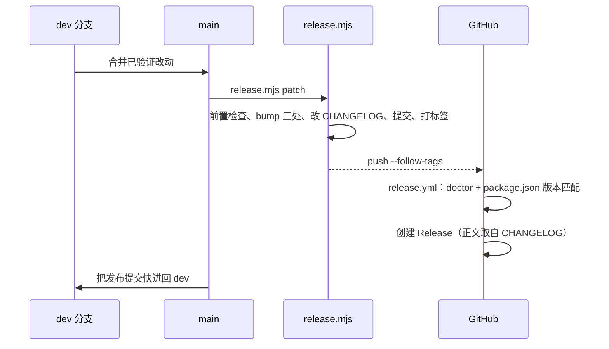

# 构建与发布

> 说明三个清单的版本同步、release.mjs 的前置检查、tag 触发的 GitHub Release；不证明某个版本已在客户端安装生效。

## 概述

发布是一条命令加一次推送：`node tools/release.mjs <patch|minor|major|x.y.z>` 同步三处版本号、更新 CHANGELOG、提交并打附注标签；推送标签后 `release.yml` 校验版本并创建 GitHub Release。普通 push 只跑 `validate.yml`，不产生 Release。



## 核心流程

### 发版命令

```bash
node tools/release.mjs patch              # 只提交与打标签，不推送
node tools/release.mjs minor --push       # 发版并推送，触发 Release
node tools/release.mjs patch --dry-run    # 只预览
```

`release.mjs` 依次执行（[release.mjs](../../../tools/release.mjs#L80)）：

1. 工作区干净。
2. 当前分支为 `main`。
3. `doctor` 通过（含三处版本一致性）。
4. 计算新版本；与当前相同则中止。
5. 目标标签不存在。
6. CHANGELOG 的 `Unreleased` 非空。
7. 写回三处清单版本（[package.json](../../../package.json)、两份 plugin.json）。
8. 把 `Unreleased` 转为 `## [x.y.z] - 日期`，并留一个空的 `Unreleased`（[CHANGELOG 更新](../../../tools/release.mjs#L171)）。
9. 提交 `chore(release): vX.Y.Z`，打**附注标签** `git tag -a`（[打标签](../../../tools/release.mjs#L179)）。

`--publish` 被显式拒绝：本脚本不发布 npm（[release.mjs](../../../tools/release.mjs#L68)）。

### 版本号怎么定

判据是“对使用者是否破坏”，不是代码量（[docs/releasing.md](../../../docs/releasing.md)）：

| 变更 | 版本 |
|---|---|
| 正文、脚本修复、文档 | PATCH |
| 新增技能或能力 | MINOR |
| 重命名/删除技能、行为契约变化 | 1.0 之前用 MINOR 承载 |

### 推送标签之后

`.github/workflows/release.yml` 在 `v*` 标签 push 时运行（[release.yml](../../../.github/workflows/release.yml#L15)）：

1. 运行 `doctor`，并断言标签名等于 `v<package.json 版本>`，版本漂移直接失败。
2. Release 不存在时，用 `changelog-section.mjs` 抽取版本段作为正文创建；已存在时跳过创建（[release.yml](../../../.github/workflows/release.yml)）。

`--follow-tags` 只推附注标签。手工移动标签时用 `git tag -fa`，否则轻量标签不会被推送，Release 也就不会触发。

### 校验工作流

`validate.yml` 在 push 到 `main`、`dev` 和 PR 上运行（[validate.yml](../../../.github/workflows/validate.yml#L7)）：

- Node 22 与 24 两个版本：`doctor`、`npm test`。
- 各清单 JSON 可解析、脚本语法检查、CHANGELOG 版本段可提取、版本号与标签状态提示。

npm 分发当前停用：`publish.yml` 仅手动触发，`release.mjs` 不发布 npm（[docs/npm-publishing.md](../../../docs/npm-publishing.md)）。

## 关键实现

| 职责 | 位置 |
|---|---|
| 前置检查 | [release.mjs](../../../tools/release.mjs#L80) |
| 版本计算 | [release.mjs](../../../tools/release.mjs#L109) |
| 标签与推送 | [release.mjs](../../../tools/release.mjs#L179) |
| Release 正文抽取 | [changelog-section.mjs](../../../tools/changelog-section.mjs) |

## 修改须知

- 发版必须在 `main` 且工作区干净；知识或文档同步若形成后续提交，把尚未推送的标签用 `git tag -fa` 移到检查通过的提交。
- 标签推送后不要移动远端标签：已发布内容有问题就发新版本。
- 三处版本号由脚本同步，手工只改一处会被 `doctor` 与 `release.yml` 的版本匹配检查拦下。
- 工作流成功只说明校验与 Release 创建成功，不代表用户已安装或某个客户端已生效。

<details><summary>来源</summary>

- [tools/release.mjs](../../../tools/release.mjs)
- [tools/changelog-section.mjs](../../../tools/changelog-section.mjs)
- [.github/workflows/release.yml](../../../.github/workflows/release.yml)
- [.github/workflows/validate.yml](../../../.github/workflows/validate.yml)
- [.github/workflows/publish.yml](../../../.github/workflows/publish.yml)
- [CHANGELOG.md](../../../CHANGELOG.md)
- [docs/releasing.md](../../../docs/releasing.md)
- [docs/npm-publishing.md](../../../docs/npm-publishing.md)

</details>
