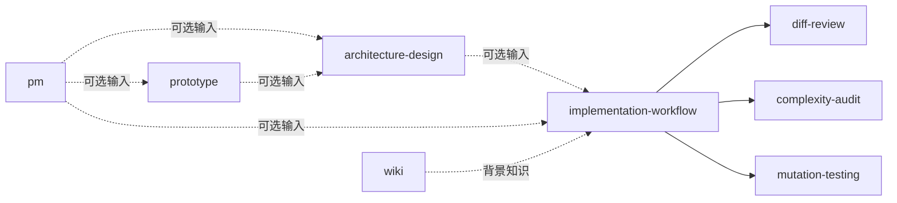

# 技能套件与分工

> 列出十三个技能的分组、适用场景与调用策略，说明技能之间不互相调度；不展开单个技能的执行步骤。

## 概述

十三个技能按开发者会问的问题分三组：需求与设计、实施与质量、协作与知识。技能之间没有固定调用依赖，用户决定是否组合与顺序；每个技能都以“用户当前已有的材料”为输入，不要求先跑上游技能。

| 分组 | 技能 | 一句话 | 调用策略 |
|---|---|---|---|
| 需求与设计 | `pm` | 把想法整理成可评审的 PRD（默认 HTML） | 用户可调用 |
| 需求与设计 | `prototype` | 把 PRD 或页面需求转为可走查的 HTML 原型 | 用户可调用 |
| 需求与设计 | `architecture-design` | 完成系统设计并交付含图示的 HTML | 用户可调用 |
| 需求与设计 | `architecture-scout` | 架构机会调查，只报告、允许零候选 | 仅用户主动调用 |
| 需求与设计 | `research` | 多步取证、交叉验证的问题调查 | 用户可调用 |
| 需求与设计 | `test-design` | 基于业务规则设计测试用例（默认 HTML） | 用户可调用 |
| 实施与质量 | `implementation-workflow` | 评估、拆分、调度实施，按风险调用评审与审计 | 用户可调用 |
| 实施与质量 | `bug-debugging` | 定位根因，用户确认方案后修复 | 用户可调用 |
| 实施与质量 | `diff-review` | 正确性、规范、需求三轴评审 diff | 用户可调用 |
| 实施与质量 | `complexity-audit` | 复杂度与覆盖率风险审计（CRAP） | 用户可调用 |
| 实施与质量 | `mutation-testing` | 用已有突变工具审计测试有效性 | 用户可调用 |
| 协作与知识 | `wiki` | 生成并维护项目 Wiki | 用户可调用 |
| 协作与知识 | `worktree` | 创建与删除 Git worktree | 用户可调用 |

## 核心流程

虚线表示“可以带上的材料”，不是必须前置的步骤。缺 PRD 不阻塞实施，缺测试用例时实施技能在任务内补足必要验证；关键取舍由用户决定。

### 调用策略

- 默认技能允许用户与模型调用；`architecture-scout` 只接受用户主动调用，避免模型自行发起全仓调查（[SKILL.md](../../../skills/architecture-scout/SKILL.md)）。
- DSH 侧的 `dsh-model-invocable`、`disable-model-invocation`、`user-invocable` 由桥接解释（[src/index.js](../../../src/index.js#L145)）；Codex 侧 `architecture-scout` 用 `agents/openai.yaml` 固定同样的策略。

### 技能之间不互相调度

技能可以引用其他技能已有的产物，但不调用它们。`wiki` 尤其如此：其他技能不调度 Wiki，也不在收尾时夹带知识检查。需要跨技能协作时由用户组合。

## 关键实现

| 职责 | 位置 |
|---|---|
| 技能清单与描述 | [skills/](../../../skills) |
| 调用策略字段 | [skills/architecture-scout/SKILL.md](../../../skills/architecture-scout/SKILL.md) |
| DSH 调用策略解释 | [src/index.js](../../../src/index.js#L143) |

## 修改须知

- 新增技能要同时更新三处清单的描述、`doctor` 的命名检查与版本号，见[构建与发布](../guides/release.md)。
- 改变技能的默认可调用性属于行为契约变化，按 MINOR 处理。
- 技能改名会使 `/agentforge:<旧名>` 立即失效，属于破坏性变更。

来源

- [skills/pm/SKILL.md](../../../skills/pm/SKILL.md)
- [skills/prototype/SKILL.md](../../../skills/prototype/SKILL.md)
- [skills/architecture-design/SKILL.md](../../../skills/architecture-design/SKILL.md)
- [skills/architecture-scout/SKILL.md](../../../skills/architecture-scout/SKILL.md)
- [skills/research/SKILL.md](../../../skills/research/SKILL.md)
- [skills/test-design/SKILL.md](../../../skills/test-design/SKILL.md)
- [skills/implementation-workflow/SKILL.md](../../../skills/implementation-workflow/SKILL.md)
- [skills/bug-debugging/SKILL.md](../../../skills/bug-debugging/SKILL.md)
- [skills/diff-review/SKILL.md](../../../skills/diff-review/SKILL.md)
- [skills/complexity-audit/SKILL.md](../../../skills/complexity-audit/SKILL.md)
- [skills/mutation-testing/SKILL.md](../../../skills/mutation-testing/SKILL.md)
- [skills/wiki/SKILL.md](../../../skills/wiki/SKILL.md)
- [skills/worktree/SKILL.md](../../../skills/worktree/SKILL.md)

