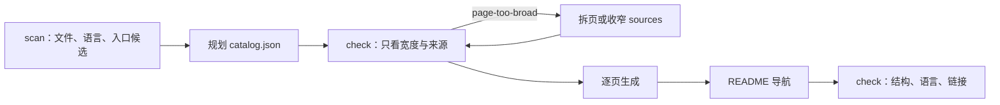

# Wiki 技能

> 说明 wiki 技能的 scan、catalog 目录、逐页生成与 check 判定规则及脚本边界；不重复技能内的写作规范与模板正文。

## 概述

wiki 技能为代码仓库生成并维护 `docs/wiki/`：`catalog.json` 是目录真源，`README.md` 是入口，每页开头一行摘要、页尾列出来源。生成主线只有两个命令——`scan` 和 `check`；旧版 `wiki.config.json` 结构（`mapping`、`freshness`、`review`、`gate`）已移除。

| 文件 | 职责 |
|---|---|
| [SKILL.md](../../../skills/wiki/SKILL.md) | 任务入口：生成、阅读、更新、检查 |
| [generate.md](../../../skills/wiki/references/generate.md) | 扫描、规划 catalog、确认、逐页生成、收尾 |
| [writing.md](../../../skills/wiki/references/writing.md) | 页面结构、语言、以代码为准、链接与修订规则 |
| [tools.md](../../../skills/wiki/references/tools.md) | 命令、问题代码表与结果语义 |
| [scripts/](../../../skills/wiki/scripts) | `wiki.mjs` 入口、`scan.mjs`、`catalog.mjs` |
| [assets/pages/](../../../skills/wiki/assets/pages) | 四种页面模板：overview、architecture、module、guide |

## 核心流程

`scan` 只读输出文件清单、编程语言分布、入口候选、目录体量与语言建议；语言信号按类别最多抽样 200 个文件。`check` 要求 wiki 目录存在 `catalog.json`，没有时以退出码 2 报错。

### catalog.json

字段白名单：`version`（必须为 2）、`title`、`language`、`pathLanguage`、`pages`；每页 `id`、`title`、`path`、`summary`、`sources`、`children`、`status`（只允许 `planned`）。未知字段、非法版本、重复 id、非 Markdown 路径都会以退出码 2 报错（[parseCatalog](../../../skills/wiki/scripts/catalog.mjs#L20)）。

| 检查 | 行为 |
|---|---|
| 页面存在 | `planned` 可缺；已生成的页面再标 `planned` 报 `planned-page-exists` |
| 来源存在 | 缺失报 `missing-source`；目录会展开为文件 |
| 开头摘要 | 一级标题与紧随的引用块必须存在，且与 catalog `summary` 一致 |
| 语言 | 正文主要语言仅支持中英文；模板双语标题报 `bilingual-heading` |
| 可达性 | 未列入 catalog 的页面报 `uncatalogued-page`；从 README 不可达报 `unreachable-page` |

### 页面宽度与拆页

宽度 = `sources` 展开后的文件 + 正文链接到的文件，去重，不计 Markdown，README 除外。阈值固定在脚本中：

| 宽度 | 结果 |
|---|---|
| ≤ 15 | 通过 |
| 16～30 | `coverage.catalog.oversized`，只作提示 |
| > 30 | `page-too-broad`，退出码 1 |

阈值不放进 catalog，因为 catalog 由生成方编写，可配置等于自评。正文链接计入是为了防止只把 `sources` 写窄绕过检查；更新时同样适用（[catalog.mjs](../../../skills/wiki/scripts/catalog.mjs#L15)）。

### 检查结果语义

`passed` / `issues` / `partial` / `error` 对应退出码 0 / 1 / 1 / 2。`partial` 表示存在无法检查的部分（如嵌套列表缩进、复杂 HTML、符号链接、项目根外链接），要读 `coverage.limitations`。`semantic: not_run` 表示脚本不判断正文是否正确，结论仍要回到代码核实。

## 关键实现

| 职责 | 位置 |
|---|---|
| 命令与参数解析（仅 scan、check） | [wiki.mjs](../../../skills/wiki/scripts/wiki.mjs#L12) |
| Markdown 链接与锚点解析 | [wiki.mjs](../../../skills/wiki/scripts/wiki.mjs#L94) |
| 代码链接收集（宽度计数的另一半） | [wiki.mjs](../../../skills/wiki/scripts/wiki.mjs#L155) |
| catalog 检查主体 | [checkCatalog](../../../skills/wiki/scripts/catalog.mjs#L74) |
| 语言判定阈值 | [verdict](../../../skills/wiki/scripts/scan.mjs#L35) |

## 配置与扩展

- `--root` 默认当前 Git 根，不在 Git 仓库内必须显式传入；`--wiki` 默认 `docs/wiki`。
- 页面模板只给结构，没有内容的小节删除；模板里的章节名写成“中文 / English”，生成时只保留 `language` 一侧。
- 语言确定顺序与路径语言规则见 [generate.md](../../../skills/wiki/references/generate.md)；写作规则见 [writing.md](../../../skills/wiki/references/writing.md)。

## 修改须知

- 改 `sources` 会让该页的宽度重新计算；改 `path` 或 `children` 要同步所有入链与 `README.md`。
- 新增检查代码时同步 `tools.md` 的问题代码表与 `tests/wiki-*.test.mjs`。
- 脚本只读；`check` 不修改任何文件。生成与更新只改文档，不改代码、不部署、不读凭据。

来源

- [skills/wiki/SKILL.md](../../../skills/wiki/SKILL.md)
- [skills/wiki/references/generate.md](../../../skills/wiki/references/generate.md)
- [skills/wiki/references/tools.md](../../../skills/wiki/references/tools.md)
- [skills/wiki/references/writing.md](../../../skills/wiki/references/writing.md)
- [skills/wiki/scripts/catalog.mjs](../../../skills/wiki/scripts/catalog.mjs)
- [skills/wiki/scripts/scan.mjs](../../../skills/wiki/scripts/scan.mjs)
- [skills/wiki/scripts/wiki.mjs](../../../skills/wiki/scripts/wiki.mjs)
- [skills/wiki/assets/pages](../../../skills/wiki/assets/pages)

