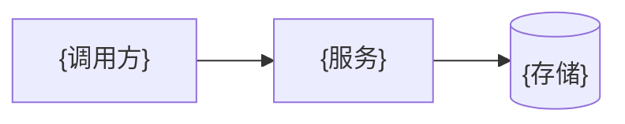

<!-- 架构页模板。至少一张 Mermaid 图；节点 ID 用 ASCII，节点文字用 catalog.language；章节名与来源标题只保留 catalog.language 一种，对照见 references/writing.md。 -->
# {系统架构}

> {一句话：系统由哪些部分组成、边界在哪。与 catalog summary 一致。}

## 概述 / Overview
{整体结构、运行形态、关键约束。}

## 组件 / Components

| 组件 | 职责 | 位置 |
|---|---|---|
| {名称} | {做什么、不做什么} | [{符号或文件}]({相对路径}#L{行号}) |

## 数据流 / Data Flow
{一条主链路从入口到出口，引用对应代码。}

## 外部依赖 / External Dependencies
{依赖的服务、配置入口和失败时的表现；未验证的写明。}

## 设计取舍 / Design Decisions
{代码或文档中能找到依据的取舍；推断就近标注。}

来源 / Sources

- {与 catalog sources 一致}

