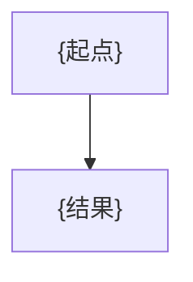

<!-- 指南页模板：关键流程、部署、运维、开发指南共用，按主题增删小节；章节名与来源标题只保留 catalog.language 一种，对照见 references/writing.md。 -->
# {主题}

> {一句话：读完能完成什么。与 catalog summary 一致。}

## 适用场景 / When to Use
{什么情况下读这一页，前置条件。}

## 步骤 / Steps
1. {操作}：`{命令原样}`，见 [{文件}]({相对路径})

## 流程图 / Flow

{跨模块流程保留本节；纯操作指南可删除。}

## 排障 / Troubleshooting
| 现象 | 原因 | 处理 |
|---|---|---|
| {错误信息原文} | {依据代码或日志} | {做法} |

来源 / Sources

- {与 catalog sources 一致}

