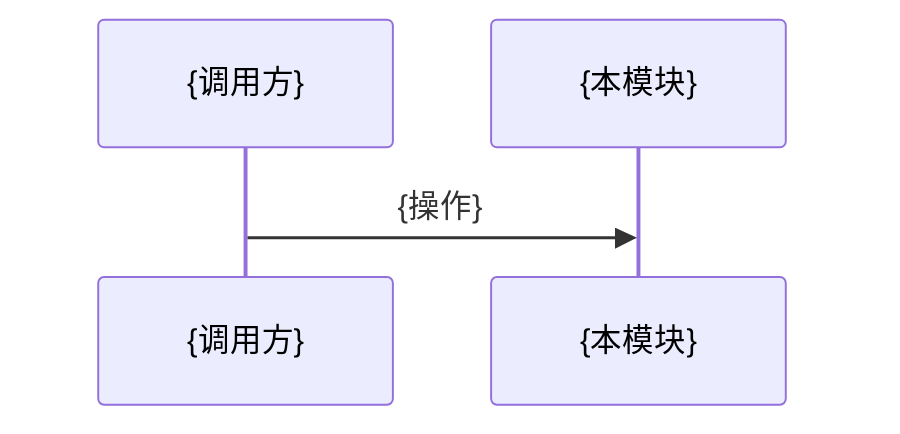

<!-- 模块页模板。按能力而非目录划分；关键结论就近链接源码；章节名与来源标题只保留 catalog.language 一种，对照见 references/writing.md。 -->
# {模块名}

> {一句话：负责什么、不负责什么（链接到负责它的页面）。与 catalog summary 一致。}

## 概述 / Overview
{这个能力解决的开发问题、对外接口、主要使用方。}

## 核心流程 / Core Flow

{按步骤说明，每步链接到实现。}

## 关键实现 / Key Implementation
| 职责 | 位置 |
|---|---|
| {入口 / 规则 / 存储} | [{符号}]({相对路径}#L{行号}) |

## 配置与扩展 / Configuration and Extension
{配置键、扩展点、默认值；原样保留键名。无内容则删除本节。}

## 修改须知 / Notes for Changes
{改动时容易破坏的约束、需要同步的地方、相关测试。}

来源 / Sources

- {与 catalog sources 一致}

